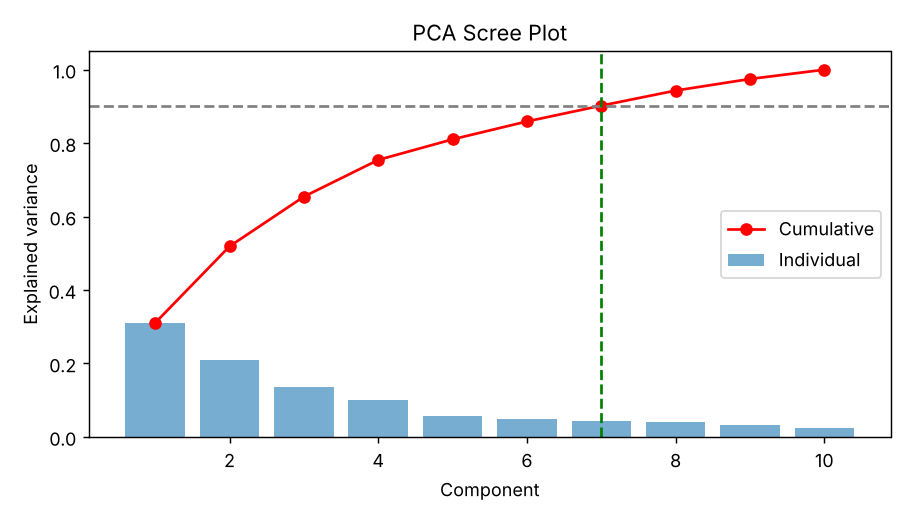

# PCA Summary
- Features used: 10 (numeric only; Department analysed after clustering), standardised with StandardScaler.
- Components kept: **7** (cumulative variance 90.2%; threshold 90%).
- PC1 / PC2 explain 31.1% / 20.8%.

Top loadings (full table in `pca_loadings.csv`):

|                         |   PC1 |   PC2 |
|:------------------------|------:|------:|
| TrainingHours           |  0.05 |  0.54 |
| OverTimeHours           | -0.12 | -0.48 |
| MonthlyIncome           |  0.48 | -0.13 |
| YearsAtCompany          |  0.47 | -0.11 |
| WorkLifeBalance         |  0.19 |  0.43 |
| YearsSinceLastPromotion | -0.21 | -0.41 |
| Age                     |  0.4  | -0.22 |
| PerformanceRating       |  0.39 | -0.19 |

