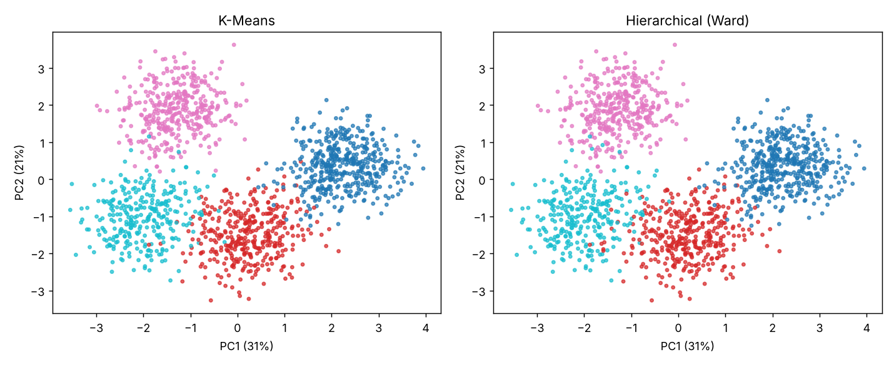
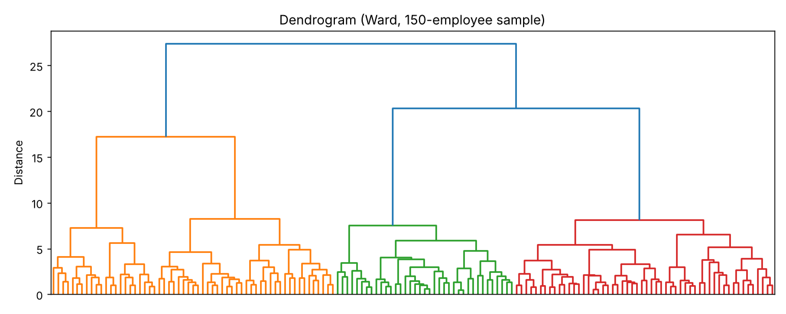

# Employee Segmentation Report
**Data:** 1500 employees, 10 numeric features (Department profiled after clustering).
**Method:** StandardScaler -> PCA (7 components) -> K-Means and Ward hierarchical clustering.

## Choosing K
Silhouette peaked at K=4 (score 0.363); elbow plot in `figures/kmeans_k_selection.png`.
Hierarchical (Ward, K=4) silhouette 0.361; agreement with K-Means (ARI) = 0.974.

## Cluster profiles (K-Means)
|   KMeans_Cluster |   Size |   Age |   Income |   Tenure |   YrsSincePromo |   Performance |   JobSat |   WorkLife |   OT_Hours |   Training |   AttritionRate | RiskTier   | Persona                       |
|-----------------:|-------:|------:|---------:|---------:|----------------:|--------------:|---------:|-----------:|-----------:|-----------:|----------------:|:-----------|:------------------------------|
|                0 |    450 | 41.3  |  9551.4  |    11.14 |            1.99 |          3.8  |     3.48 |       3.24 |       3.42 |      25.32 |            0.04 | Low        | Stable Veterans               |
|                1 |    369 | 36.17 |  6471.68 |     6.11 |            3.06 |          4.14 |     3.39 |       1.98 |      13.97 |      19.41 |            0.08 | High       | Burnout-Prone High Performers |
|                2 |    378 | 28.02 |  3872.62 |     2.28 |            1.64 |          2.98 |     2.94 |       2.95 |       4.38 |      39.53 |            0.06 | Medium     | Early-Career Learners         |
|                3 |    303 | 32.77 |  5083.17 |     3.86 |            4.95 |          2.58 |     2.02 |       2.39 |       8.17 |       8.91 |            0.16 | High       | Disengaged & At-Risk          |

## High-risk / retention-risk clusters
|   KMeans_Cluster | Persona                       |   Size |   AttritionRate |   JobSat |   WorkLife |   OT_Hours |   YrsSincePromo |
|-----------------:|:------------------------------|-------:|----------------:|---------:|-----------:|-----------:|----------------:|
|                1 | Burnout-Prone High Performers |    369 |            0.08 |     3.39 |       1.98 |      13.97 |            3.06 |
|                3 | Disengaged & At-Risk          |    303 |            0.16 |     2.02 |       2.39 |       8.17 |            4.95 |

## Department-level segments (share of each department)
| Department   |   Burnout-Prone High Performers |   Disengaged & At-Risk |   Early-Career Learners |   Stable Veterans |
|:-------------|--------------------------------:|-----------------------:|------------------------:|------------------:|
| Engineering  |                           0.28  |                  0.208 |                   0.211 |             0.3   |
| Finance      |                           0.219 |                  0.225 |                   0.284 |             0.272 |
| HR           |                           0.295 |                  0.164 |                   0.287 |             0.254 |
| Operations   |                           0.205 |                  0.201 |                   0.265 |             0.328 |
| Sales        |                           0.242 |                  0.205 |                   0.257 |             0.297 |
| Support      |                           0.232 |                  0.19  |                   0.261 |             0.318 |

## Performance groups by persona (share of persona)
| Persona                       |   Low |   Core |   High |
|:------------------------------|------:|-------:|-------:|
| Burnout-Prone High Performers | 0.003 |  0.333 |  0.664 |
| Disengaged & At-Risk          | 0.809 |  0.191 |  0     |
| Early-Career Learners         | 0.476 |  0.513 |  0.011 |
| Stable Veterans               | 0.016 |  0.642 |  0.342 |

## Recommendations (edit using your own reading of the numbers)
1. Target the high-risk persona with stay interviews, promotion review and workload rebalancing.
2. Cap overtime for burnout-prone high performers; they are costly to lose.
3. Invest in training and career paths for early-career learners to build tenure.

